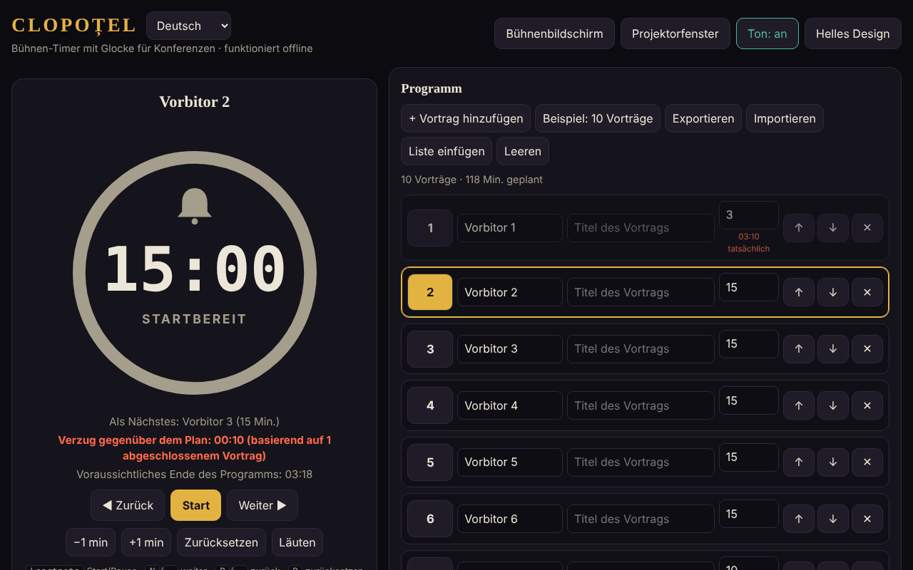

# CLOPOȚEL

[English](README.md) · [Română](README.ro.md) · [Français](README.fr.md) · [Italiano](README.it.md) · [Español](README.es.md) · [Português](README.pt.md) · **Deutsch** · [Magyar](README.hu.md)

**Version:** 2.1.0 · **Zuletzt aktualisiert:** 2026-10-27

**Farben je Phase (2.1.0).** Unter Einstellungen lässt sich die Farbe der normalen Phase, der Warnung und der Überziehung wählen. Eine Farbe mit einem Kontrast unter 3:1 zum Hintergrund wird mit einer Meldung abgelehnt; jede Phase behält außerdem ihre Textbeschriftung. „Standardfarben“ stellt das ursprüngliche Aussehen wieder her. Die Fußzeile verweist jetzt auch auf die Mehrbildschirm-Synchronisierung für andere Geräte. Oberflächentexte automatisch übersetzt (maschinelle Übersetzung, nicht von Muttersprachlern geprüft).

**Status:** stabil · **Offline:** vollständig

Oberflächensprachen: **Română, English, Français, Italiano, Español, Português (PT), Deutsch, Magyar**

Ein Bühnen-Timer mit Glocke für Konferenzen: Er begrenzt die Zeit jedes Redners im Programm.
Eine einzige HTML-Datei, ohne externe Abhängigkeiten, die vollständig offline funktioniert („ohne Grenzen“, trade-free).

## Verwendung

1. Öffnen Sie `index.html` in einem Browser (oder die mit GitHub Pages veröffentlichte Seite: **https://chiuta.github.io/Clopotel/**).
2. Füllen Sie das Programm aus: Redner, Titel, zugeteilte Minuten. Sie können das Programm verschieben, löschen, exportieren und importieren (JSON) oder als Textliste einfügen (**Liste einfügen**: `Vorbitor | Titlu | minute`, eine Präsentation pro Zeile; Trennzeichen `|`, `;` oder Tabulator; ohne Minutenangabe werden 10 verwendet). `.csv`/`.txt`-Dateien im selben Format lassen sich ebenso importieren.
3. Drücken Sie **Start**. Die Glocke läutet bei der Warnung (standardmäßig 2 Minuten vorher), am Ende und in der Überziehung periodisch.
4. **Bühnenbildschirm** zeigt den Timer im Vollbild; **Projektorfenster** öffnet ein zweites, synchronisiertes Fenster
   (derselbe Browser, derselbe Computer), das Sie auf den Saalbildschirm verschieben.

## Neue Funktionen (v1.1.0, 14. Oktober 2026)

Funktionen, die nach dem Lesen der Anwendung ausgewählt wurden, für das, was einem Veranstalter nach der Veranstaltung und im Saal fehlte:

### Bericht: Plan gegenüber Ist
Der einklappbare Abschnitt „Bericht: Plan gegenüber Ist“ (unter Einstellungen) zeigt für jede Präsentation die geplante Zeit, die tatsächliche Zeit, die Differenz (rot = überschritten, grün = unter Plan), den Status (beendet / läuft / nicht begonnen) und Summen: die Summe der gestoppten Präsentationen und den Plan des gesamten Programms. Er aktualisiert sich in Echtzeit. „CSV exportieren“ lädt `raport-clopotel.csv` herunter (Trennzeichen `;`, UTF-8 mit BOM für Excel/LibreOffice; Zellen, die als Formeln interpretiert werden könnten, werden neutralisiert); „Bericht drucken“ druckt nur die Tabelle. Die Zeiten stammen aus den Ergebnissen, die Clopoțel bereits führt (eine Präsentation kommt in den Bericht, wenn sie beendet oder verlassen wird, die aktuelle mit der bisherigen Zeit). **Einschränkung:** Es gibt keinen Verlauf früherer Veranstaltungen; ein „Zurücksetzen“ oder „Auswählen“ bei einer Präsentation löscht deren tatsächliche Zeit aus dem Bericht (bestehendes Verhalten).

### Sprachansagen (optional)
Das Kontrollkästchen „Sprachansagen“ in den Einstellungen: Bei der Warnung und am Ende wird zusätzlich zur Glocke laut „Au rămas 2 minute.“ / „A rămas un minut.“ / „Au rămas N secunde.“ / „Timpul a expirat.“ gesprochen (also „Noch 2 Minuten.“ / „Noch eine Minute.“ / „Noch N Sekunden.“ / „Die Zeit ist abgelaufen.“; auf Englisch, wenn die Sprache En ist). Es nutzt die Sprachsynthese des Browsers (`speechSynthesis`), beachtet die Lautstärke und den Schalter „Ton“ (bei ausgeschaltetem Ton wird nicht gesprochen), ist standardmäßig aus und deaktiviert sich automatisch, wenn der Browser keine Stimme hat. Das Projektorfenster spricht nicht (um Doppelungen zu vermeiden). **Einschränkung:** Qualität und Sprache der Stimme hängen vom System ab; manche Systeme haben keine rumänische Stimme und lesen mit fremdem Akzent; manche Stimmen werden online vom Browserhersteller bereitgestellt, außerhalb der Kontrolle der Anwendung.

Die Oberfläche hat 8 Sprachen (RO, EN, FR, IT, ES, PT, DE, HU), die im Sprachwähler ausgewählt werden; auch das Kit hat seine Oberfläche in 8 Sprachen.

### Transparenz und Sicherungskopie (fff-kit)

Ein Klick (oder Eingabe) auf die angezeigte Version (`v 1.1.1 · 2026-10-18`) öffnet das Fenster „Transparenz“: die deklarierten Netzwerk-Hosts (0 externe Anfragen), die lokalen Speicherschlüssel mit Größen, die verwendeten APIs, Größe und SHA-256 der Datei (mit einer Prüfung für eine heruntergeladene Datei) und die **Sicherungskopie** der Anwendungsdaten in einer `.fff.json`-Datei (optional mit Passwort verschlüsselt, AES-GCM 256 / PBKDF2; das Passwort lässt sich nicht wiederherstellen), Import mit Bestätigung und Löschen der Anwendungsdaten. Das Kit (`fff-kit`, Module: core, label, bundle) ist in `index.html` eingefügt, stellt keine Netzwerkanfragen und ändert keine vorhandenen Daten; ohne es funktioniert die Anwendung genauso. Die Texte des Kits liegen in 8 Sprachen vor (ro, en, fr, it, es, pt, hu, de); **die Übersetzungen fr/it/es/pt/hu/de sind automatisch und nicht muttersprachlich geprüft**. Die Oberfläche der Anwendung selbst bleibt auf Rumänisch.

## Tastenkürzel

| Taste | Aktion |
|---|---|
| Leertaste | Start / Pause |
| N oder → | Nächster Redner |
| P oder ← | Vorheriger |
| R | Zurücksetzen |
| + / − | Eine Minute hinzufügen / abziehen |
| B | Glocke läuten |
| M | Ton ein / aus |
| F | Bühnenbildschirm |

## Hinweise

- Der Sprachwähler neben dem Titel schaltet die Oberfläche zwischen den 8 Sprachen um (die Auswahl wird im Browser gespeichert; das Projektorfenster folgt ihr).
- Die Schaltfläche **Helles/dunkles Design** wechselt das Design (standardmäßig dunkel, passend für die Bühne); die Auswahl wird im Browser gespeichert. Der Druck (Strg+P) erzeugt nur das Programm, in Schwarzweiß.
- Der Browser blockiert den Ton bis zum ersten Klick: Drücken Sie vor der Veranstaltung Start oder eine beliebige Schaltfläche.
- Die Daten (Programm, Einstellungen, Timer-Zustand) werden im Browser gespeichert (`localStorage`); nach einem Neuladen läuft der Timer weiter.
- Der Bildschirm bleibt eingeschaltet, solange der Timer läuft (Wake Lock, wo der Browser es unterstützt).

## Veröffentlichung mit GitHub Pages

Settings → Pages → Source: *Deploy from a branch* → `main` / `(root)`. Die Datei `.nojekyll` ist bereits enthalten.

## Verlauf / Changelog

### 1.2.5 — 2026-10-23
- Die nativen Dialoge alert/confirm/prompt wurden durch barrierefreie, übersetzte FFF.dialog-Dialoge ersetzt (fff-kit 1.2.0).

### 1.2.3 — 2026-10-22
- fff-kit 1.1.4: Touch-Ziele und Mindestschriftgröße; Touch-Ziele/Text korrigiert

### 1.2.2 — 2026-10-22
- fff-kit 1.1.2: PBKDF2 mit 600.000 Iterationen, Schutz vor Clickjacking

### 1.2.1 — 2026-10-22
- Fehler beim Dateiimport (leere Datei, ungültiges JSON) und die Meldung zum blockierten Popup sind keine blockierenden `alert()`-Dialoge mehr: Sie erscheinen als nicht-modale Benachrichtigung in der aktuellen Sprache (auch für Screenreader angekündigt).
- Mobil: Der Lautstärkeregler und die beiden Kontrollkästchen haben größere Tippflächen; die Versionsangabe in der Fußzeile zeigt jetzt die aktuelle Version.

### 1.1.1 — 18. Oktober 2026
- Der Import eines Programms aus einer Datei (`.json`, `.csv`, `.txt`) verlangt jetzt eine Bestätigung, bevor das bestehende Programm ersetzt wird (wie bei „Liste einfügen“); wenn Sie verzichten, ändern sich weder das Programm noch die Einstellungen. Nach dem Ersetzen gibt es kein „Rückgängig“: Exportieren Sie das Programm vor dem Import.

### 1.1.0 — 14. Oktober 2026
- Bericht Plan/Ist (+ CSV, Druck); optionale Sprachansagen; fff-kit (Transparenz + Sicherungskopie); die einklappbaren Abschnitte Einstellungen und Bericht liegen jetzt in einer Landmarke (`aside`) für die Barrierefreiheit (axe `region` war zuvor verletzt).

### 1.0.0 — 12. Oktober 2026
- Die Version und das Datum der letzten Aktualisierung werden in der Anwendung angezeigt (Fußzeile).

### 11.10.2026 (dritte Aktualisierung) — 11. Oktober 2026
- Oberfläche in zwei Sprachen: Rumänisch und Englisch (Schaltfläche neben dem Titel), einschließlich ARIA-Beschriftungen, Meldungen, Tastenkürzeln und Hilfetext; mit axe in beiden Sprachen geprüft.
- Die Zeile „Vorsprung/Rückstand gegenüber dem Plan“ zeigt jetzt, auf wie vielen beendeten Präsentationen die Berechnung beruht (vermeidet Verwirrung nach einem schnellen Durchgang durch die Redner).
- CSP: `connect-src 'none'` (die Anwendung stellt keine Netzwerkanfragen).

### 11.10.2026 (zweite Aktualisierung) — 11. Oktober 2026
- Programmimport aus eingefügtem Text oder aus einer `.csv`/`.txt`-Datei (Zeilen `Vorbitor | Titlu | minute`), mit einer Meldung über die importierten oder angepassten Zeilen.
- Helles Design (Kontrast mit axe geprüft) und Druckstil für das Programm; das Projektorfenster folgt dem gewählten Design.

### 11.10.2026 — 11. Oktober 2026
- Projektorfenster: Blockiert der Browser das Popup-Fenster, erscheint jetzt eine klare Meldung mit den nötigen Schritten (statt keiner Reaktion).
- Eine strikte Content-Security-Policy hinzugefügt (Skript per Hash, kein Netzwerk); axe-Prüfung ohne Verstöße.

## Lizenz

MIT — siehe [LICENSE](LICENSE).

Autor: Alexandru-Ionuț Chiuță (Alexio) · <alexio@trom.tf>
