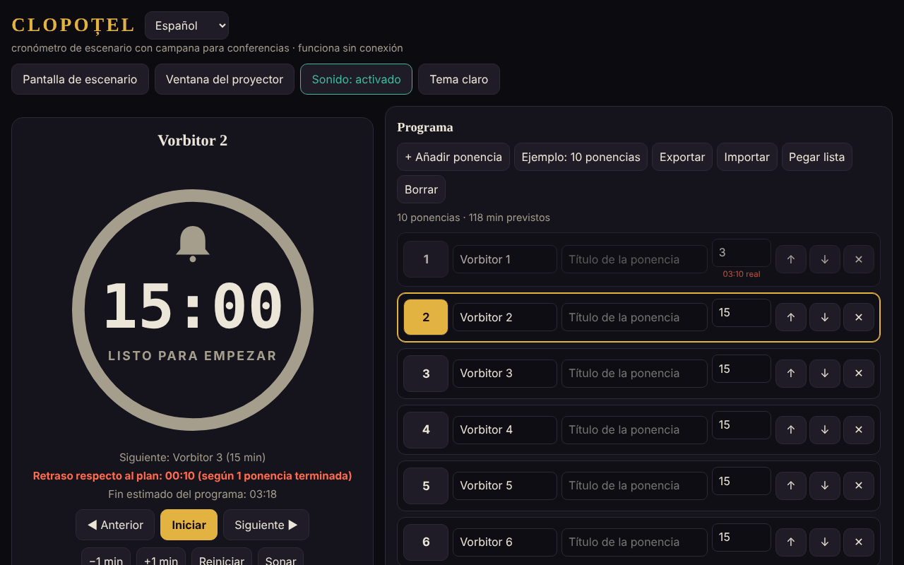

# CLOPOȚEL

[English](README.md) · [Română](README.ro.md) · [Français](README.fr.md) · [Italiano](README.it.md) · **Español** · [Português](README.pt.md) · [Deutsch](README.de.md) · [Magyar](README.hu.md)

**Versión:** 2.1.0 · **Última actualización:** 2026-10-27

**Estado:** estable · **Sin conexión:** completo

Idiomas de la interfaz: **Română, English, Français, Italiano, Español, Português (PT), Deutsch, Magyar**

Cronómetro de escenario con campanilla para conferencias: limita el tiempo de cada ponente del programa.
Un único archivo HTML, sin dependencias externas, que funciona totalmente sin conexión («sin fronteras», trade-free).

## Uso

1. Abre `index.html` en un navegador (o la página publicada con GitHub Pages: **https://chiuta.github.io/Clopotel/**).
2. Rellena el programa: ponente, título, minutos asignados. Puedes mover, borrar, exportar e importar el programa (JSON), o pegarlo como lista de texto (**Pegar lista**: `Vorbitor | Titlu | minute`, una presentación por línea; separadores `|`, `;` o tabulador; sin minutos se usan 10). Los archivos `.csv`/`.txt` con el mismo formato se importan igual.
3. Pulsa **Start**. La campanilla suena en el aviso (por defecto 2 minutos antes), al final y periódicamente si se excede el tiempo.
4. **Pantalla de escenario** pone el cronómetro a pantalla completa; **Ventana para el proyector** abre una segunda ventana sincronizada
   (mismo navegador, mismo ordenador) que mueves a la pantalla de la sala.

## Funciones nuevas (v1.1.0, 14 de octubre de 2026)

Funciones elegidas tras leer la aplicación, por lo que le faltaba a un organizador después del evento y en la sala:

### Informe: previsto frente a real
La sección plegable «Informe: previsto frente a real» (bajo Ajustes) muestra, para cada presentación, el tiempo previsto, el tiempo real, la diferencia (rojo = excedido, verde = por debajo de lo previsto), el estado (terminada / en curso / sin empezar) y los totales: la suma de las presentaciones cronometradas y lo previsto de todo el programa. Se actualiza en tiempo real. «Exportar CSV» descarga `raport-clopotel.csv` (separador `;`, UTF-8 con BOM para Excel/LibreOffice; las celdas que podrían interpretarse como fórmulas se neutralizan); «Imprimir el informe» imprime solo la tabla. Los tiempos proceden de los resultados que Clopoțel ya guarda (una presentación entra en el informe cuando termina o se abandona; la actual, con el tiempo transcurrido hasta ahora). **Límite:** no hay historial de eventos anteriores; un «Reiniciar» o «Seleccionar» sobre una presentación borra su tiempo real del informe (comportamiento existente).

### Anuncios por voz (opcional)
La casilla «Anuncios por voz» en Ajustes: en el aviso y al final, además de la campanilla, se dice en voz alta «Au rămas 2 minute.» / «A rămas un minut.» / «Au rămas N secunde.» / «Timpul a expirat.» (es decir, «Quedan 2 minutos.» / «Queda un minuto.» / «Quedan N segundos.» / «El tiempo ha terminado.»; en inglés cuando el idioma es En). Usa la síntesis de voz del navegador (`speechSynthesis`), respeta el volumen y el interruptor «Sonido» (con el sonido apagado no se habla), está desactivada por defecto y se desactiva automáticamente si el navegador no tiene voz. La ventana para el proyector no habla (para evitar duplicados). **Límite:** la calidad y el idioma de la voz dependen del sistema; algunos sistemas no tienen voz rumana y leen con acento extranjero; algunas voces las proporciona en línea el fabricante del navegador, fuera del control de la aplicación.

La interfaz tiene 8 idiomas (RO, EN, FR, IT, ES, PT, DE, HU), que se eligen en el selector de idioma; el kit también tiene su interfaz en 8 idiomas.

### Transparencia y copia de seguridad (fff-kit)

Un clic (o Intro) en la versión mostrada (`v 1.1.1 · 2026-10-18`) abre la ventana «Transparencia»: los hosts de red declarados (0 solicitudes externas), las claves de almacenamiento local con sus tamaños, las API usadas, el tamaño y el SHA-256 del archivo (con un verificador para un archivo descargado) y la **copia de seguridad** de los datos de la aplicación en un archivo `.fff.json` (opcionalmente cifrado con contraseña, AES-GCM 256 / PBKDF2; la contraseña no se puede recuperar), la importación con confirmación y el borrado de los datos de la aplicación. El kit (`fff-kit`, módulos: core, label, bundle) está pegado en `index.html`, no hace solicitudes de red y no cambia los datos existentes; sin él, la aplicación funciona igual. Los textos del kit están en 8 idiomas (ro, en, fr, it, es, pt, hu, de); **las traducciones fr/it/es/pt/hu/de son automáticas y no están verificadas por nativos**. La interfaz de la propia aplicación sigue en rumano.

## Atajos

| Tecla | Acción |
|---|---|
| Espacio | Iniciar / pausa |
| N o → | Siguiente ponente |
| P o ← | Anterior |
| R | Reiniciar |
| + / − | Sumar / restar un minuto |
| B | Hacer sonar la campanilla |
| M | Sonido activado / desactivado |
| F | Pantalla de escenario |

## Notas

- El selector de idioma junto al título cambia la interfaz entre los 8 idiomas (la elección se guarda en el navegador; la ventana para el proyector la sigue).
- El botón **Tema claro/oscuro** cambia el tema (oscuro por defecto, adecuado para el escenario); la elección se guarda en el navegador. La impresión (Ctrl+P) produce solo el programa, en blanco y negro.
- El navegador bloquea el sonido hasta el primer clic: pulsa Start o cualquier botón antes del evento.
- Los datos (programa, ajustes, estado del cronómetro) se guardan en el navegador (`localStorage`); tras una recarga, el cronómetro continúa.
- La pantalla permanece encendida mientras el cronómetro está en marcha (Wake Lock, donde el navegador lo admita).

## Publicación con GitHub Pages

Settings → Pages → Source: *Deploy from a branch* → `main` / `(root)`. El archivo `.nojekyll` ya está incluido.

## Historial / Registro de cambios

### 1.2.5 — 2026-10-23
- Los cuadros nativos alert/confirm/prompt se sustituyen por diálogos FFF.dialog accesibles y traducidos (fff-kit 1.2.0).

### 1.2.3 — 2026-10-22
- fff-kit 1.1.4: objetivos táctiles y tamaño mínimo de texto; objetivos táctiles/texto corregidos

### 1.2.2 — 2026-10-22
- fff-kit 1.1.2: PBKDF2 600 000 iteraciones, protección anti-clickjacking

### 1.2.1 — 2026-10-22
- Los errores de importación de archivos (archivo vacío, JSON no válido) y el mensaje de ventana bloqueada ya no son cuadros `alert()` bloqueantes: aparecen como una notificación no modal en el idioma actual (anunciada también a los lectores de pantalla).
- Móvil: el control de volumen y las dos casillas tienen áreas táctiles mayores; la etiqueta de versión del pie muestra ahora la versión actual.

### 1.1.1 — 18 de octubre de 2026
- La importación de un programa desde un archivo (`.json`, `.csv`, `.txt`) pide ahora confirmación antes de sustituir el programa existente (como «Pegar lista»); si desistes, no cambian ni el programa ni los ajustes. No hay «deshacer» tras la sustitución: exporta el programa antes de importar.

### 1.1.0 — 14 de octubre de 2026
- Informe previsto/real (+ CSV, impresión); anuncios por voz opcionales; fff-kit (Transparencia + copia de seguridad); las secciones plegables Ajustes e Informe están ahora en una región de referencia (`aside`) por accesibilidad (antes se incumplía axe `region`).

### 1.0.0 — 12 de octubre de 2026
- La versión y la fecha de la última actualización se muestran en la aplicación (pie de página).

### 11.10.2026 (tercera actualización) — 11 de octubre de 2026
- Interfaz en dos idiomas: rumano e inglés (botón junto al título), incluidas las etiquetas ARIA, los mensajes, los atajos y el texto de ayuda; verificada con axe en ambos idiomas.
- La línea «Adelanto/Retraso respecto a lo previsto» muestra ahora en cuántas presentaciones terminadas se basa el cálculo (evita confusiones tras un paso rápido por los ponentes).
- CSP: `connect-src 'none'` (la aplicación no hace solicitudes de red).

### 11.10.2026 (segunda actualización) — 11 de octubre de 2026
- Importación del programa desde texto pegado o desde un archivo `.csv`/`.txt` (líneas `Vorbitor | Titlu | minute`), con un mensaje sobre las líneas importadas o ajustadas.
- Tema claro (contraste verificado con axe) y estilo de impresión para el programa; la ventana para el proyector sigue el tema elegido.

### 11.10.2026 — 11 de octubre de 2026
- Ventana para el proyector: si el navegador bloquea la ventana emergente, aparece ahora un mensaje claro con los pasos a seguir (en lugar de ninguna reacción).
- Añadida una Content-Security-Policy estricta (script por hash, sin red); comprobación axe sin infracciones.

## Licencia

MIT — consulta [LICENSE](LICENSE).

Autor: Alexandru-Ionuț Chiuță (Alexio) · <alexio@trom.tf>
