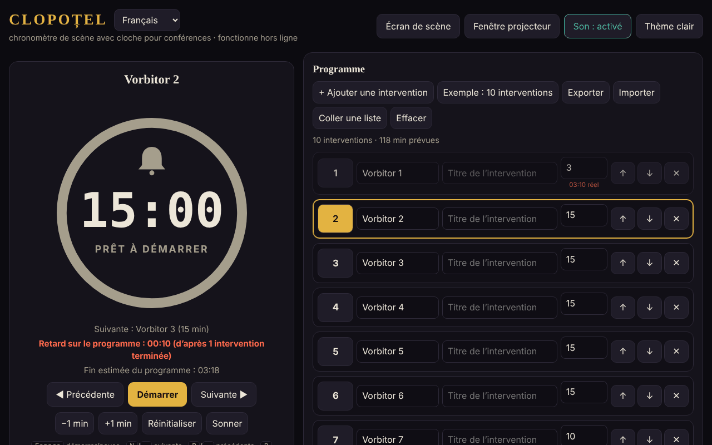

# CLOPOȚEL

[English](README.md) · [Română](README.ro.md) · **Français** · [Italiano](README.it.md) · [Español](README.es.md) · [Português](README.pt.md) · [Deutsch](README.de.md) · [Magyar](README.hu.md)

**Version :** 1.2.5 · **Dernière mise à jour :** 2026-10-23

Langues de l'interface : **Română, English, Français, Italiano, Español, Português (PT), Deutsch, Magyar**

Chronomètre de scène avec clochette pour les conférences : il limite le temps de parole de chaque intervenant de l'ordre du jour.
Un seul fichier HTML, sans dépendances externes, entièrement hors ligne (« sans frontières », trade-free).

## Utilisation

1. Ouvrez `index.html` dans un navigateur (ou la page publiée avec GitHub Pages : **https://chiuta.github.io/Clopotel/**).
2. Remplissez l'ordre du jour : intervenant, titre, minutes allouées. Vous pouvez déplacer, supprimer, exporter et importer l'ordre du jour (JSON), ou le coller sous forme de liste de texte (**Coller une liste** : `Vorbitor | Titlu | minute`, une présentation par ligne ; séparateurs `|`, `;` ou tabulation ; sans minutes, 10 sont utilisées). Les fichiers `.csv`/`.txt` ayant le même format s'importent de la même manière.
3. Appuyez sur **Start**. La clochette sonne à l'avertissement (par défaut 2 minutes avant), à la fin, puis périodiquement en cas de dépassement.
4. **Écran de scène** place le chronomètre en plein écran ; **Fenêtre pour le projecteur** ouvre une seconde fenêtre synchronisée
   (même navigateur, même ordinateur) que vous déplacez sur l'écran de la salle.

## Nouvelles fonctions (v1.1.0, 14 octobre 2026)

Fonctions choisies après lecture de l'application, pour ce qui manquait à un organisateur après l'événement et dans la salle :

### Rapport : prévu et réel
La section repliable « Rapport : prévu et réel » (sous Paramètres) affiche, pour chaque présentation, le temps prévu, le temps réel, l'écart (rouge = dépassement, vert = sous le prévu), l'état (terminée / en cours / non commencée) et des totaux : la somme des présentations chronométrées et le prévu de l'ensemble de l'ordre du jour. Elle se met à jour en temps réel. « Exporter en CSV » télécharge `raport-clopotel.csv` (séparateur `;`, UTF-8 avec BOM pour Excel/LibreOffice ; les cellules pouvant être interprétées comme des formules sont neutralisées) ; « Imprimer le rapport » n'imprime que le tableau. Les temps proviennent des résultats que Clopoțel conserve déjà (une présentation entre dans le rapport lorsqu'elle est terminée ou quittée, la présentation en cours avec le temps écoulé jusque-là). **Limite :** il n'y a pas d'historique des événements précédents ; un « Réinitialiser » ou « Sélectionner » sur une présentation supprime son temps réel du rapport (comportement existant).

### Annonces vocales (facultatif)
La case « Annonces vocales » dans les Paramètres : à l'avertissement et à la fin, en plus de la clochette, l'application dit à voix haute « Au rămas 2 minute. » / « A rămas un minut. » / « Au rămas N secunde. » / « Timpul a expirat. » (c'est-à-dire « Il reste 2 minutes. » / « Il reste une minute. » / « Il reste N secondes. » / « Le temps est écoulé. » ; en anglais lorsque la langue est En). Elle utilise la synthèse vocale du navigateur (`speechSynthesis`), respecte le volume et l'interrupteur « Son » (son coupé, aucune parole), est désactivée par défaut et se désactive automatiquement si le navigateur n'a pas de voix. La fenêtre pour le projecteur ne parle pas (pour éviter le doublon). **Limite :** la qualité et la langue de la voix dépendent du système ; certains systèmes n'ont pas de voix roumaine et lisent avec un accent étranger ; certaines voix sont fournies en ligne par l'éditeur du navigateur, hors du contrôle de l'application.

L'interface compte 8 langues (RO, EN, FR, IT, ES, PT, DE, HU), choisies dans le sélecteur de langue ; le kit a lui aussi son interface en 8 langues.

### Transparence et copie de sauvegarde (fff-kit)

Un clic (ou Entrée) sur la version affichée (`v 1.1.1 · 2026-10-18`) ouvre la fenêtre « Transparence » : les hôtes réseau déclarés (0 requête externe), les clés de stockage local avec leurs tailles, les API utilisées, la taille et le SHA-256 du fichier (avec un vérificateur pour un fichier téléchargé) et la **copie de sauvegarde** des données de l'application dans un fichier `.fff.json` (éventuellement chiffré par mot de passe, AES-GCM 256 / PBKDF2 ; le mot de passe ne peut pas être récupéré), l'import avec confirmation et la suppression des données de l'application. Le kit (`fff-kit`, modules : core, label, bundle) est collé dans `index.html`, ne fait aucune requête réseau et ne modifie pas les données existantes ; sans lui, l'application fonctionne de la même façon. Les textes du kit sont en 8 langues (ro, en, fr, it, es, pt, hu, de) ; **les traductions fr/it/es/pt/hu/de sont automatiques et non vérifiées par des natifs**. L'interface de l'application elle-même reste en roumain.

## Raccourcis

| Touche | Action |
|---|---|
| Espace | Démarrer / pause |
| N ou → | Intervenant suivant |
| P ou ← | Précédent |
| R | Réinitialiser |
| + / − | Ajouter / retirer une minute |
| B | Faire sonner la clochette |
| M | Son activé / désactivé |
| F | Écran de scène |

## Notes

- Le sélecteur de langue à côté du titre fait basculer l'interface entre les 8 langues (le choix est conservé dans le navigateur ; la fenêtre pour le projecteur le suit).
- Le bouton **Thème clair/sombre** change le thème (sombre par défaut, adapté à la scène) ; le choix est conservé dans le navigateur. L'impression (Ctrl+P) ne produit que l'ordre du jour, en noir et blanc.
- Le navigateur bloque le son jusqu'au premier clic : appuyez sur Start ou sur n'importe quel bouton avant l'événement.
- Les données (ordre du jour, paramètres, état du chronomètre) sont conservées dans le navigateur (`localStorage`) ; après un rechargement, le chronomètre continue.
- L'écran reste allumé tant que le chronomètre tourne (Wake Lock, là où le navigateur le prend en charge).

## Publication avec GitHub Pages

Settings → Pages → Source : *Deploy from a branch* → `main` / `(root)`. Le fichier `.nojekyll` est déjà inclus.

## Historique / Journal des modifications

### 1.2.5 — 2026-10-23
- Les boîtes natives alert/confirm/prompt sont remplacées par des dialogues FFF.dialog accessibles et traduits (fff-kit 1.2.0).

### 1.2.3 — 2026-10-22
- fff-kit 1.1.4 : cibles tactiles et taille de texte minimale ; cibles tactiles/texte corrigés

### 1.2.2 — 2026-10-22
- fff-kit 1.1.2 : PBKDF2 600 000 itérations, protection anti-clickjacking

### 1.2.1 — 2026-10-22
- Les erreurs d'importation de fichier (fichier vide, JSON invalide) et le message de fenêtre bloquée ne sont plus des boîtes `alert()` bloquantes : elles s'affichent comme une notification non modale dans la langue courante (annoncée aussi aux lecteurs d'écran).
- Mobile : le curseur de volume et les deux cases à cocher ont des zones tactiles plus grandes ; l'étiquette de version du pied de page affiche maintenant la version actuelle.

### 1.1.1 — 18 octobre 2026
- L'importation d'un ordre du jour depuis un fichier (`.json`, `.csv`, `.txt`) demande désormais une confirmation avant de remplacer l'ordre du jour existant (comme « Coller une liste ») ; si vous renoncez, ni l'ordre du jour ni les paramètres ne changent. Il n'y a pas d'« annulation » après le remplacement : exportez l'ordre du jour avant d'importer.

### 1.1.0 — 14 octobre 2026
- Rapport prévu/réel (+ CSV, impression) ; annonces vocales facultatives ; fff-kit (Transparence + copie de sauvegarde) ; les sections repliables Paramètres et Rapport sont désormais dans un repère (`aside`) pour l'accessibilité (axe `region` était auparavant violé).

### 1.0.0 — 12 octobre 2026
- La version et la date de la dernière mise à jour sont affichées dans l'application (pied de page).

### 11.10.2026 (troisième mise à jour) — 11 octobre 2026
- Interface en deux langues : roumain et anglais (bouton à côté du titre), y compris les étiquettes ARIA, les messages, les raccourcis et le texte d'aide ; vérifié avec axe dans les deux langues.
- La ligne « Avance/Retard sur le prévu » indique désormais sur combien de présentations terminées repose le calcul (évite la confusion après un passage rapide sur les intervenants).
- CSP : `connect-src 'none'` (l'application ne fait aucune requête réseau).

### 11.10.2026 (deuxième mise à jour) — 11 octobre 2026
- Importation de l'ordre du jour depuis du texte collé ou depuis un fichier `.csv`/`.txt` (lignes `Vorbitor | Titlu | minute`), avec un message sur les lignes importées ou ajustées.
- Thème clair (contraste vérifié avec axe) et style d'impression pour l'ordre du jour ; la fenêtre pour le projecteur suit le thème choisi.

### 11.10.2026 — 11 octobre 2026
- Fenêtre pour le projecteur : si le navigateur bloque la fenêtre contextuelle, un message clair avec les étapes à suivre apparaît désormais (au lieu d'aucune réaction).
- Ajout d'une Content-Security-Policy stricte (script par empreinte, sans réseau) ; vérification axe sans violation.

## Licence

MIT — voir [LICENSE](LICENSE).

Auteur : Alexandru-Ionuț Chiuță (Alexio) · <alexio@trom.tf>
