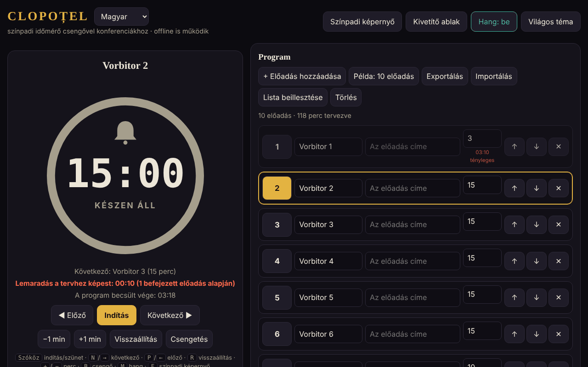

# CLOPOȚEL

[English](README.md) · [Română](README.ro.md) · [Français](README.fr.md) · [Italiano](README.it.md) · [Español](README.es.md) · [Português](README.pt.md) · [Deutsch](README.de.md) · **Magyar**

**Verzió:** 1.2.1 · **Utolsó frissítés:** 2026-10-22

A felület nyelvei: **Română, English, Français, Italiano, Español, Português (PT), Deutsch, Magyar**

Színpadi időmérő csengővel konferenciákhoz: korlátozza a program minden előadójának idejét.
Egyetlen HTML-fájl, külső függőségek nélkül, teljesen offline működik („határok nélkül”, trade-free).

## Használat

1. Nyisd meg az `index.html` fájlt egy böngészőben (vagy a GitHub Pages-szel közzétett oldalt: **https://chiuta.github.io/Clopotel/**).
2. Töltsd ki a programot: előadó, cím, kiosztott percek. A programot mozgathatod, törölheted, exportálhatod és importálhatod (JSON), vagy szöveges listaként beillesztheted (**Lista beillesztése**: `Vorbitor | Titlu | minute`, soronként egy előadás; elválasztók: `|`, `;` vagy tabulátor; perc megadása nélkül 10-et használ). Az ugyanilyen formátumú `.csv`/`.txt` fájlok ugyanígy importálhatók.
3. Nyomd meg a **Start** gombot. A csengő a figyelmeztetéskor szól (alapértelmezés szerint 2 perccel korábban), a végén, és időtúllépés esetén időszakosan.
4. A **Színpadi képernyő** teljes képernyőre teszi az időmérőt; az **Ablak a kivetítőhöz** egy második, szinkronizált ablakot nyit
   (ugyanaz a böngésző, ugyanaz a számítógép), amelyet a terem képernyőjére húzol át.

## Új funkciók (v1.1.0, 2026. október 14.)

Az alkalmazás elolvasása után kiválasztott funkciók, arra, ami egy szervezőnek hiányzott az esemény után és a teremben:

### Jelentés: terv és tény
Az összecsukható „Jelentés: terv és tény” szakasz (a Beállítások alatt) minden előadásnál megmutatja a tervezett időt, a tényleges időt, a különbséget (piros = túllépés, zöld = a terv alatt), az állapotot (befejezett / folyamatban / nem kezdődött el) és az összegeket: a mért előadások összegét és a teljes program tervét. Valós időben frissül. Az „Exportálás CSV-be” letölti a `raport-clopotel.csv` fájlt (elválasztó `;`, UTF-8 BOM-mal az Excel/LibreOffice számára; a képletként értelmezhető cellák semlegesítve vannak); a „Jelentés nyomtatása” csak a táblázatot nyomtatja. Az idők azokból az eredményekből származnak, amelyeket a Clopoțel már tárol (egy előadás akkor kerül a jelentésbe, ha befejeződött vagy elhagyták, az aktuális pedig az addig eltelt idővel). **Korlát:** nincs előzmény a korábbi eseményekről; egy előadáson a „Visszaállítás” vagy a „Kijelölés” törli annak tényleges idejét a jelentésből (meglévő viselkedés).

### Hangbemondások (opcionális)
A „Hangbemondások” jelölőnégyzet a Beállításokban: a figyelmeztetéskor és a végén a csengő mellett hangosan elhangzik, hogy „Au rămas 2 minute.” / „A rămas un minut.” / „Au rămas N secunde.” / „Timpul a expirat.” (vagyis „2 perc van hátra.” / „Egy perc van hátra.” / „N másodperc van hátra.” / „Az idő lejárt.”; angolul, ha a nyelv En). A böngésző beszédszintézisét használja (`speechSynthesis`), tiszteletben tartja a hangerőt és a „Hang” kapcsolót (kikapcsolt hangnál nem beszél), alapértelmezés szerint ki van kapcsolva, és automatikusan letiltódik, ha a böngészőnek nincs hangja. A kivetítő ablaka nem beszél (a duplázás elkerülése végett). **Korlát:** a hang minősége és nyelve a rendszertől függ; egyes rendszereken nincs román hang, és idegen akcentussal olvasnak; egyes hangokat online a böngésző gyártója biztosít, az alkalmazás ellenőrzésén kívül.

A felület 8 nyelvű (RO, EN, FR, IT, ES, PT, DE, HU), a nyelvválasztóból választható; a készlet (kit) felülete is 8 nyelvű.

### Átláthatóság és biztonsági másolat (fff-kit)

A megjelenített verzióra (`v 1.1.1 · 2026-10-18`) kattintva (vagy Entert nyomva) megnyílik az „Átláthatóság” ablak: a deklarált hálózati hosztok (0 külső kérés), a helyi tárolókulcsok méretekkel, a használt API-k, a fájl mérete és SHA-256 értéke (ellenőrzővel a letöltött fájlhoz), valamint az alkalmazás adatainak **biztonsági másolata** egy `.fff.json` fájlban (opcionálisan jelszóval titkosítva, AES-GCM 256 / PBKDF2; a jelszó nem állítható vissza), importálás megerősítéssel és az alkalmazás adatainak törlése. A készlet (`fff-kit`, modulok: core, label, bundle) be van illesztve az `index.html` fájlba, nem küld hálózati kéréseket, és nem módosítja a meglévő adatokat; nélküle az alkalmazás ugyanúgy működik. A készlet szövegei 8 nyelven vannak (ro, en, fr, it, es, pt, hu, de); **az fr/it/es/pt/hu/de fordítások automatikusak és anyanyelvi beszélő nem ellenőrizte őket**. Magának az alkalmazásnak a felülete román nyelvű marad.

## Gyorsbillentyűk

| Billentyű | Művelet |
|---|---|
| Szóköz | Start / szünet |
| N vagy → | Következő előadó |
| P vagy ← | Előző |
| R | Visszaállítás |
| + / − | Egy perc hozzáadása / levonása |
| B | Csengő megszólaltatása |
| M | Hang be / ki |
| F | Színpadi képernyő |

## Megjegyzések

- A cím melletti nyelvválasztó vált a felület 8 nyelve között (a választás a böngészőben marad; a kivetítő ablaka követi).
- A **Világos/sötét téma** gomb váltja a témát (alapértelmezés szerint sötét, színpadhoz illő); a választás a böngészőben marad. A nyomtatás (Ctrl+P) csak a programot állítja elő, fekete-fehérben.
- A böngésző az első kattintásig letiltja a hangot: az esemény előtt nyomd meg a Start vagy bármelyik gombot.
- Az adatok (program, beállítások, az időmérő állapota) a böngészőben tárolódnak (`localStorage`); újratöltés után az időmérő folytatódik.
- A képernyő bekapcsolva marad, amíg az időmérő fut (Wake Lock, ahol a böngésző támogatja).

## Közzététel a GitHub Pages-szel

Settings → Pages → Source: *Deploy from a branch* → `main` / `(root)`. A `.nojekyll` fájl már benne van.

## Előzmények / Változásnapló

### 1.2.1 — 2026-10-22
- A fájlimportálási hibák (üres fájl, érvénytelen JSON) és a blokkolt felugró ablak üzenete már nem blokkoló `alert()` párbeszédablakok: nem modális értesítésként jelennek meg az aktuális nyelven (a képernyőolvasók is felolvassák).
- Mobil: a hangerő-csúszka és a két jelölőnégyzet nagyobb érintési felületű; a lábléc verziócímkéje most az aktuális verziót mutatja.

### 1.1.1 — 2026. október 18.
- Egy program fájlból (`.json`, `.csv`, `.txt`) történő importálása mostantól megerősítést kér a meglévő program lecserélése előtt (mint a „Lista beillesztése”); ha letérsz róla, sem a program, sem a beállítások nem változnak. A csere után nincs „visszavonás”: importálás előtt exportáld a programot.

### 1.1.0 — 2026. október 14.
- Terv/tény jelentés (+ CSV, nyomtatás); opcionális hangbemondások; fff-kit (Átláthatóság + biztonsági másolat); az összecsukható Beállítások és Jelentés szakaszok mostantól tájékozódási pontban (`aside`) vannak a hozzáférhetőség érdekében (az axe `region` szabálya korábban sérült).

### 1.0.0 — 2026. október 12.
- A verzió és az utolsó frissítés dátuma megjelenik az alkalmazásban (lábléc).

### 11.10.2026 (harmadik frissítés) — 2026. október 11.
- Kétnyelvű felület: román és angol (gomb a cím mellett), az ARIA-címkékkel, üzenetekkel, gyorsbillentyűkkel és súgószöveggel együtt; mindkét nyelven ellenőrizve az axe-szel.
- Az „Előny/Hátrány a tervhez képest” sor mostantól megmutatja, hány befejezett előadásra épül a számítás (elkerüli a zavart az előadók gyors átlépkedése után).
- CSP: `connect-src 'none'` (az alkalmazás nem küld hálózati kéréseket).

### 11.10.2026 (második frissítés) — 2026. október 11.
- A program importálása beillesztett szövegből vagy `.csv`/`.txt` fájlból (`Vorbitor | Titlu | minute` sorok), üzenettel az importált vagy módosított sorokról.
- Világos téma (kontraszt az axe-szel ellenőrizve) és nyomtatási stílus a programhoz; a kivetítő ablaka követi a választott témát.

### 11.10.2026 — 2026. október 11.
- Ablak a kivetítőhöz: ha a böngésző blokkolja a felugró ablakot, mostantól világos üzenet jelenik meg a követendő lépésekkel (ahelyett, hogy semmi nem történne).
- Szigorú Content-Security-Policy hozzáadva (szkript ellenőrzőösszeggel, hálózat nélkül); axe-ellenőrzés szabálysértés nélkül.

## Licenc

MIT — lásd a [LICENSE](LICENSE) fájlt.

Szerző: Alexandru-Ionuț Chiuță (Alexio) · <alexio@trom.tf>
