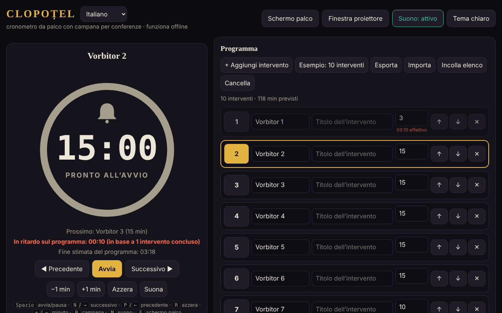

# CLOPOȚEL

[English](README.md) · [Română](README.ro.md) · [Français](README.fr.md) · **Italiano** · [Español](README.es.md) · [Português](README.pt.md) · [Deutsch](README.de.md) · [Magyar](README.hu.md)

**Versione:** 2.1.0 · **Ultimo aggiornamento:** 2026-10-27

**Stato:** stabile · **Offline:** completo

Lingue dell'interfaccia: **Română, English, Français, Italiano, Español, Português (PT), Deutsch, Magyar**

Cronometro da palco con campanello per le conferenze: limita il tempo di ogni relatore in programma.
Un unico file HTML, senza dipendenze esterne, completamente offline («senza frontiere», trade-free).

## Utilizzo

1. Apri `index.html` in un browser (oppure la pagina pubblicata con GitHub Pages: **https://chiuta.github.io/Clopotel/**).
2. Compila il programma: relatore, titolo, minuti assegnati. Puoi spostare, eliminare, esportare e importare il programma (JSON) oppure incollarlo come elenco di testo (**Incolla elenco**: `Vorbitor | Titlu | minute`, una presentazione per riga; separatori `|`, `;` o tabulazione; senza minuti se ne usano 10). I file `.csv`/`.txt` con lo stesso formato si importano allo stesso modo.
3. Premi **Start**. Il campanello suona all'avviso (per impostazione predefinita 2 minuti prima), alla fine e periodicamente in caso di sforamento.
4. **Schermo da palco** porta il cronometro a schermo intero; **Finestra per il proiettore** apre una seconda finestra sincronizzata
   (stesso browser, stesso computer) che sposti sullo schermo della sala.

## Nuove funzioni (v1.1.0, 14 ottobre 2026)

Funzioni scelte dopo aver letto l'applicazione, per ciò che mancava a un organizzatore dopo l'evento e in sala:

### Resoconto: previsto e reale
La sezione comprimibile «Resoconto: previsto e reale» (sotto Impostazioni) mostra, per ogni presentazione, il tempo previsto, il tempo reale, la differenza (rosso = superato, verde = sotto il previsto), lo stato (conclusa / in corso / non iniziata) e i totali: la somma delle presentazioni cronometrate e il previsto dell'intero programma. Si aggiorna in tempo reale. «Esporta CSV» scarica `raport-clopotel.csv` (separatore `;`, UTF-8 con BOM per Excel/LibreOffice; le celle che potrebbero essere interpretate come formule vengono neutralizzate); «Stampa il resoconto» stampa solo la tabella. I tempi provengono dai risultati che Clopoțel già conserva (una presentazione entra nel resoconto quando è conclusa o abbandonata, quella corrente con il tempo trascorso finora). **Limite:** non esiste uno storico degli eventi precedenti; un «Reimposta» o «Seleziona» su una presentazione cancella il suo tempo reale dal resoconto (comportamento esistente).

### Annunci vocali (facoltativo)
La casella «Annunci vocali» nelle Impostazioni: all'avviso e alla fine, oltre al campanello, viene detto a voce alta «Au rămas 2 minute.» / «A rămas un minut.» / «Au rămas N secunde.» / «Timpul a expirat.» (cioè «Mancano 2 minuti.» / «Manca un minuto.» / «Mancano N secondi.» / «Il tempo è scaduto.»; in inglese quando la lingua è En). Usa la sintesi vocale del browser (`speechSynthesis`), rispetta il volume e l'interruttore «Suono» (con il suono disattivato non si parla), è disattivata per impostazione predefinita e si disattiva automaticamente se il browser non ha voci. La finestra per il proiettore non parla (per evitare il doppione). **Limite:** la qualità e la lingua della voce dipendono dal sistema; alcuni sistemi non hanno una voce rumena e leggono con accento straniero; alcune voci sono fornite online dal produttore del browser, fuori dal controllo dell'applicazione.

L'interfaccia ha 8 lingue (RO, EN, FR, IT, ES, PT, DE, HU), scelte dal selettore di lingua; anche il kit ha l'interfaccia in 8 lingue.

### Trasparenza e copia di riserva (fff-kit)

Un clic (o Invio) sulla versione mostrata (`v 1.1.1 · 2026-10-18`) apre la finestra «Trasparenza»: gli host di rete dichiarati (0 richieste esterne), le chiavi di archiviazione locale con le dimensioni, le API usate, la dimensione e lo SHA-256 del file (con un verificatore per un file scaricato) e la **copia di riserva** dei dati dell'applicazione in un file `.fff.json` (facoltativamente cifrato con password, AES-GCM 256 / PBKDF2; la password non può essere recuperata), l'importazione con conferma e la cancellazione dei dati dell'applicazione. Il kit (`fff-kit`, moduli: core, label, bundle) è incollato in `index.html`, non effettua richieste di rete e non modifica i dati esistenti; senza di esso l'applicazione funziona allo stesso modo. I testi del kit sono in 8 lingue (ro, en, fr, it, es, pt, hu, de); **le traduzioni fr/it/es/pt/hu/de sono automatiche e non verificate da madrelingua**. L'interfaccia dell'applicazione stessa resta in rumeno.

## Scorciatoie

| Tasto | Azione |
|---|---|
| Spazio | Start / pausa |
| N o → | Relatore successivo |
| P o ← | Precedente |
| R | Reimposta |
| + / − | Aggiungi / sottrai un minuto |
| B | Suona il campanello |
| M | Suono attivo / disattivo |
| F | Schermo da palco |

## Note

- Il selettore di lingua accanto al titolo commuta l'interfaccia tra le 8 lingue (la scelta viene conservata nel browser; la finestra per il proiettore la segue).
- Il pulsante **Tema chiaro/scuro** cambia il tema (scuro per impostazione predefinita, adatto al palco); la scelta viene conservata nel browser. La stampa (Ctrl+P) produce solo il programma, in bianco e nero.
- Il browser blocca l'audio fino al primo clic: premi Start o un qualsiasi pulsante prima dell'evento.
- I dati (programma, impostazioni, stato del cronometro) vengono conservati nel browser (`localStorage`); dopo un ricaricamento, il cronometro continua.
- Lo schermo resta acceso finché il cronometro è in funzione (Wake Lock, dove il browser lo supporta).

## Pubblicazione con GitHub Pages

Settings → Pages → Source: *Deploy from a branch* → `main` / `(root)`. Il file `.nojekyll` è già incluso.

## Cronologia / Changelog

### 1.2.5 — 2026-10-23
- Le finestre native alert/confirm/prompt sono sostituite da dialoghi FFF.dialog accessibili e tradotti (fff-kit 1.2.0).

### 1.2.3 — 2026-10-22
- fff-kit 1.1.4: target touch e dimensione minima del testo; target touch/testo corretti

### 1.2.2 — 2026-10-22
- fff-kit 1.1.2: PBKDF2 600.000 iterazioni, protezione anti-clickjacking

### 1.2.1 — 2026-10-22
- Gli errori di importazione dei file (file vuoto, JSON non valido) e il messaggio della finestra bloccata non sono più finestre `alert()` bloccanti: compaiono come notifica non modale nella lingua corrente (annunciata anche agli screen reader).
- Mobile: il cursore del volume e le due caselle di controllo hanno aree di tocco più grandi; l'etichetta della versione nel piè di pagina mostra ora la versione corrente.

### 1.1.1 — 18 ottobre 2026
- L'importazione di un programma da file (`.json`, `.csv`, `.txt`) chiede ora conferma prima di sostituire il programma esistente (come «Incolla elenco»); se rinunci, né il programma né le impostazioni cambiano. Dopo la sostituzione non esiste un «annulla»: esporta il programma prima di importare.

### 1.1.0 — 14 ottobre 2026
- Resoconto previsto/reale (+ CSV, stampa); annunci vocali facoltativi; fff-kit (Trasparenza + copia di riserva); le sezioni comprimibili Impostazioni e Resoconto si trovano ora in un punto di riferimento (`aside`) per l'accessibilità (axe `region` prima era violato).

### 1.0.0 — 12 ottobre 2026
- La versione e la data dell'ultimo aggiornamento sono mostrate nell'applicazione (piè di pagina).

### 11.10.2026 (terzo aggiornamento) — 11 ottobre 2026
- Interfaccia in due lingue: rumeno e inglese (pulsante accanto al titolo), incluse le etichette ARIA, i messaggi, le scorciatoie e il testo di aiuto; verificata con axe in entrambe le lingue.
- La riga «Anticipo/Ritardo rispetto al previsto» indica ora su quante presentazioni concluse si basa il calcolo (evita confusione dopo un rapido passaggio sui relatori).
- CSP: `connect-src 'none'` (l'applicazione non effettua richieste di rete).

### 11.10.2026 (secondo aggiornamento) — 11 ottobre 2026
- Importazione del programma da testo incollato o da un file `.csv`/`.txt` (righe `Vorbitor | Titlu | minute`), con un messaggio sulle righe importate o modificate.
- Tema chiaro (contrasto verificato con axe) e stile di stampa per il programma; la finestra per il proiettore segue il tema scelto.

### 11.10.2026 — 11 ottobre 2026
- Finestra per il proiettore: se il browser blocca la finestra pop-up, compare ora un messaggio chiaro con i passaggi da seguire (invece di nessuna reazione).
- Aggiunta una Content-Security-Policy rigorosa (script tramite hash, senza rete); verifica axe senza violazioni.

## Licenza

MIT — vedi [LICENSE](LICENSE).

Autore: Alexandru-Ionuț Chiuță (Alexio) · <alexio@trom.tf>
