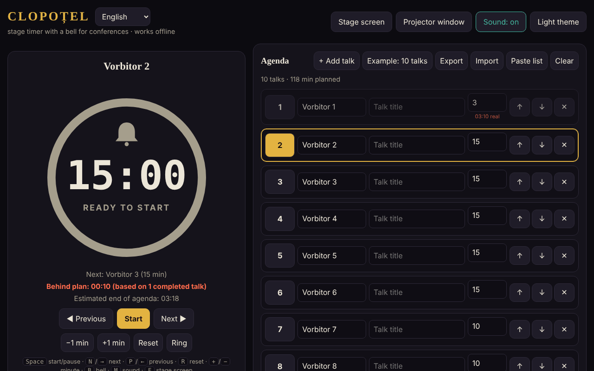

# CLOPOȚEL

**English** · [Română](README.ro.md) · [Français](README.fr.md) · [Italiano](README.it.md) · [Español](README.es.md) · [Português](README.pt.md) · [Deutsch](README.de.md) · [Magyar](README.hu.md)

**Version:** 1.2.3 · **Last updated:** 2026-10-22

Interface languages: **Română, English, Français, Italiano, Español, Português (PT), Deutsch, Magyar**

A stage timer with a bell for conferences: it limits each speaker's time on the agenda.
A single HTML file, with no external dependencies, working fully offline ("without borders", trade-free).

## Usage

1. Open `index.html` in a browser (or the page published with GitHub Pages: **https://chiuta.github.io/Clopotel/**).
2. Fill in the agenda: speaker, title, allotted minutes. You can move, delete, export and import the agenda (JSON), or paste it as a text list (**Paste list**: `Vorbitor | Titlu | minute`, one presentation per line; separators `|`, `;` or tab; without minutes, 10 is used). `.csv`/`.txt` files with the same format can be imported in the same way.
3. Press **Start**. The bell rings at the warning (by default 2 minutes before), at the end, and periodically in overtime.
4. **Stage screen** puts the timer on the full screen; **Projector window** opens a second, synchronised window
   (same browser, same computer) that you move to the room's screen.

## New features (v1.1.0, 14 October 2026)

Features chosen after reading the app, for what an organiser was missing after the event and in the room:

### Report: plan versus actual
The collapsible section "Report: plan versus actual" (under Settings) shows, for each presentation, the planned time, the actual time, the difference (red = over, green = under plan), the status (finished / in progress / not started) and totals: the sum over the timed presentations and the plan for the whole agenda. It updates in real time. "Export CSV" downloads `raport-clopotel.csv` (separator `;`, UTF-8 with BOM for Excel/LibreOffice; cells that could be interpreted as formulas are neutralised); "Print the report" prints only the table. The times come from the results that Clopoțel already keeps (a presentation enters the report when it is finished or left, the current one with the time so far). **Limit:** there is no history of previous events; a "Reset" or "Select" on a presentation deletes its actual time from the report (existing behaviour).

### Voice announcements (optional)
The "Voice announcements" checkbox in Settings: at the warning and at the end, besides the bell, the app says aloud "Au rămas 2 minute." / "A rămas un minut." / "Au rămas N secunde." / "Timpul a expirat." (i.e. "2 minutes left." / "One minute left." / "N seconds left." / "Time is up."; in English when the language is En). It uses the browser's speech synthesis (`speechSynthesis`), respects the volume and the "Sound" switch (with the sound off, nothing is spoken), is off by default and is automatically disabled if the browser has no voice. The projector window does not speak (to avoid doubling). **Limit:** the quality and language of the voice depend on the system; some systems have no Romanian voice and read with a foreign accent; some voices are provided online by the browser's maker, outside the app's control.

The interface has 8 languages (RO, EN, FR, IT, ES, PT, DE, HU), chosen from the language selector; the kit has its interface in 8 languages as well.

### Transparency and backup copy (fff-kit)

A click (or Enter) on the displayed version (`v 1.1.1 · 2026-10-18`) opens the "Transparency" window: the declared network hosts (0 external requests), the local-storage keys with sizes, the APIs used, the size and SHA-256 of the file (with a checker for a downloaded file) and the **backup copy** of the app's data in a `.fff.json` file (optionally encrypted with a password, AES-GCM 256 / PBKDF2; the password cannot be recovered), import with confirmation and deletion of the app's data. The kit (`fff-kit`, modules: core, label, bundle) is pasted into `index.html`, makes no network requests and does not change existing data; without it the app works the same. The kit's texts are in 8 languages (ro, en, fr, it, es, pt, hu, de); **the fr/it/es/pt/hu/de translations are automatic and not natively verified**. The app's own interface remains in Romanian.

## Shortcuts

| Key | Action |
|---|---|
| Space | Start / pause |
| N or → | Next speaker |
| P or ← | Previous |
| R | Reset |
| + / − | Add / subtract one minute |
| B | Ring the bell |
| M | Sound on / off |
| F | Stage screen |

## Notes

- The language selector next to the title switches the interface among the 8 languages (the choice is kept in the browser; the projector window follows it).
- The **Light/dark theme** button changes the theme (dark by default, suited to the stage); the choice is kept in the browser. Printing (Ctrl+P) produces only the agenda, in black and white.
- The browser blocks sound until the first click: press Start or any button before the event.
- The data (agenda, settings, timer state) is kept in the browser (`localStorage`); after a reload, the timer continues.
- The screen stays on while the timer is running (Wake Lock, where the browser supports it).

## Publishing with GitHub Pages

Settings → Pages → Source: *Deploy from a branch* → `main` / `(root)`. The `.nojekyll` file is already included.

## History / Changelog

### 1.2.3 — 2026-10-22
- fff-kit 1.1.4: touch targets and minimum text size; touch targets/text fixed

### 1.2.2 — 2026-10-22
- fff-kit 1.1.2: PBKDF2 600,000 iterations, anti-clickjacking protection

### 1.2.1 — 2026-10-22
- The file-import errors (empty file, invalid JSON) and the blocked pop-up message are no longer blocking `alert()` dialogs: they appear as a non-modal notification in the current language (also announced to screen readers).
- Mobile: the volume slider and the two option checkboxes have larger touch targets; the footer version label now shows the current version.

### 1.1.1 — 18 October 2026
- Importing an agenda from a file (`.json`, `.csv`, `.txt`) now asks for confirmation before replacing the existing agenda (like "Paste list"); if you back out, neither the agenda nor the settings change. There is no "undo" after replacement: export the agenda before you import.

### 1.1.0 — 14 October 2026
- Plan/actual report (+ CSV, printing); optional voice announcements; fff-kit (Transparency + backup copy); the collapsible Settings and Report sections are now in a landmark (`aside`) for accessibility (axe `region` was violated before).

### 1.0.0 — 12 October 2026
- The version and the date of the last update are shown in the app (footer).

### 11.10.2026 (third update) — 11 October 2026
- Interface in two languages: Romanian and English (button next to the title), including ARIA labels, messages, shortcuts and help text; verified with axe in both languages.
- The "Ahead/Behind plan" line now shows how many finished presentations the calculation is based on (avoids confusion after a quick pass over the speakers).
- CSP: `connect-src 'none'` (the app makes no network requests).

### 11.10.2026 (second update) — 11 October 2026
- Agenda import from pasted text or from a `.csv`/`.txt` file (lines `Vorbitor | Titlu | minute`), with a message about the imported or adjusted lines.
- Light theme (contrast verified with axe) and a print style for the agenda; the projector window follows the chosen theme.

### 11.10.2026 — 11 October 2026
- Projector window: if the browser blocks the pop-up window, a clear message with the steps to follow now appears (instead of no reaction).
- Added a strict Content-Security-Policy (script by hash, no network); axe check with no violations.

## Licence

MIT — see [LICENSE](LICENSE).

Author: Alexandru-Ionuț Chiuță (Alexio) · <alexio@trom.tf>
