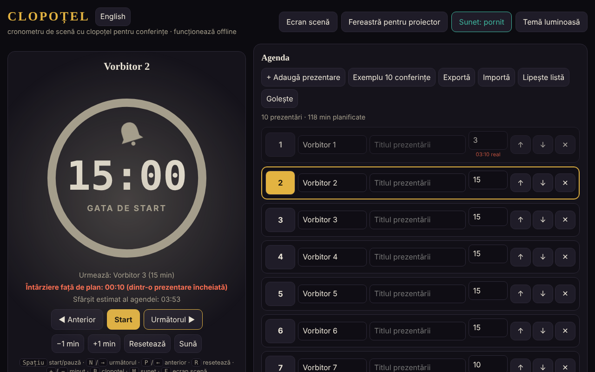

# CLOPOȚEL

Ultima actualizare: 11 octombrie 2026

Cronometru de scenă cu clopoțel pentru conferințe: limitează timpul fiecărui vorbitor din agendă.
Un singur fișier HTML, fără dependențe externe, funcționează complet offline („fără frontiere”, trade-free).

## Utilizare

1. Deschide `index.html` în browser (sau pagina publicată cu GitHub Pages: **https://chiuta.github.io/Clopotel/**).
2. Completează agenda: vorbitor, titlu, minute alocate. Poți muta, șterge, exporta și importa agenda (JSON) sau o poți lipi ca listă text (**Lipește listă**: `Vorbitor | Titlu | minute`, câte o prezentare pe rând; separatori `|`, `;` sau tab; fără minute se folosesc 10). Fișierele `.csv`/`.txt` cu același format se pot importa la fel.
3. Apasă **Start**. Clopoțelul sună la avertizare (implicit cu 2 minute înainte), la final și periodic în depășire.
4. **Ecran scenă** pune cronometrul pe tot ecranul; **Fereastră pentru proiector** deschide o a doua fereastră sincronizată
   (același browser, același calculator) pe care o muți pe ecranul sălii.

## Scurtături

| Tastă | Acțiune |
|---|---|
| Spațiu | Start / pauză |
| N sau → | Următorul vorbitor |
| P sau ← | Anterior |
| R | Resetează |
| + / − | Adaugă / scade un minut |
| B | Sună clopoțelul |
| M | Sunet pornit / oprit |
| F | Ecran scenă |

## Note

- Butonul **English / Română** de lângă titlu comută interfața între română și engleză (alegerea se păstrează în browser; fereastra pentru proiector o urmează).
- Butonul **Temă luminoasă/întunecată** schimbă tema (implicit întunecată, potrivită pentru scenă); alegerea se păstrează în browser. Tipărirea (Ctrl+P) produce doar agenda, în alb-negru.
- Browserul blochează sunetul până la primul clic: apasă Start sau orice buton înainte de eveniment.
- Datele (agenda, setările, starea cronometrului) se păstrează în browser (`localStorage`); după o reîncărcare, cronometrul continuă.
- Ecranul rămâne aprins cât timp cronometrul rulează (Wake Lock, unde browserul îl suportă).

## Publicare cu GitHub Pages

Settings → Pages → Source: *Deploy from a branch* → `main` / `(root)`. Fișierul `.nojekyll` este deja inclus.

## Istoric / Changelog

### 11.10.2026 (a treia actualizare) — 11 octombrie 2026
- Interfață în două limbi: română și engleză (buton lângă titlu), inclusiv etichete ARIA, mesaje, scurtături și text de ajutor; verificat cu axe în ambele limbi.
- Linia „Avans/Întârziere față de plan” arată acum pe câte prezentări încheiate se bazează calculul (evită confuzia după o trecere rapidă peste vorbitori).
- CSP: `connect-src 'none'` (aplicația nu face cereri de rețea).

### 11.10.2026 (a doua actualizare) — 11 octombrie 2026
- Import agendă din text lipit sau din fișier `.csv`/`.txt` (rânduri `Vorbitor | Titlu | minute`), cu mesaj despre rândurile importate sau ajustate.
- Temă luminoasă (contrast verificat cu axe) și stil de tipărire pentru agendă; fereastra pentru proiector urmează tema aleasă.

### 11.10.2026 — 11 octombrie 2026
- Fereastra pentru proiector: dacă browserul blochează fereastra pop-up, apare acum un mesaj clar cu pașii de urmat (în loc de nicio reacție).
- Adăugat Content-Security-Policy strict (script cu hash, fără rețea); verificare axe fără încălcări.

## Licență

MIT — vezi [LICENSE](LICENSE).

Autor: Alexandru-Ionuț Chiuță (Alexio) · <alexio@trom.tf>

