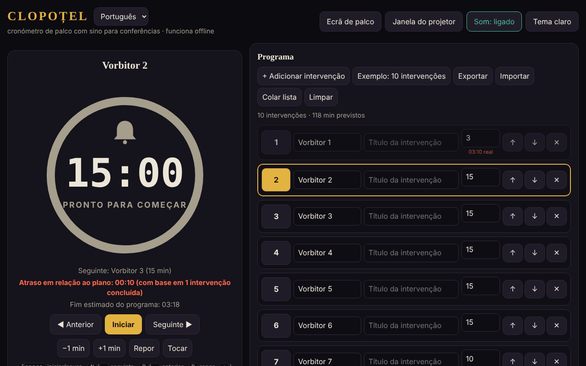

# CLOPOȚEL

[English](README.md) · [Română](README.ro.md) · [Français](README.fr.md) · [Italiano](README.it.md) · [Español](README.es.md) · **Português** · [Deutsch](README.de.md) · [Magyar](README.hu.md)

**Versão:** 2.0.0 · **Última atualização:** 2026-10-26

Idiomas da interface: **Română, English, Français, Italiano, Español, Português (PT), Deutsch, Magyar**

Cronómetro de palco com campainha para conferências: limita o tempo de cada orador da agenda.
Um único ficheiro HTML, sem dependências externas, que funciona totalmente offline («sem fronteiras», trade-free).

## Utilização

1. Abra `index.html` num navegador (ou a página publicada com o GitHub Pages: **https://chiuta.github.io/Clopotel/**).
2. Preencha a agenda: orador, título, minutos atribuídos. Pode mover, eliminar, exportar e importar a agenda (JSON), ou colá-la como lista de texto (**Colar lista**: `Vorbitor | Titlu | minute`, uma apresentação por linha; separadores `|`, `;` ou tabulação; sem minutos usam-se 10). Os ficheiros `.csv`/`.txt` com o mesmo formato importam-se da mesma forma.
3. Prima **Start**. A campainha toca no aviso (por predefinição 2 minutos antes), no fim e periodicamente em caso de excesso de tempo.
4. **Ecrã de palco** coloca o cronómetro em ecrã inteiro; **Janela para o projetor** abre uma segunda janela sincronizada
   (mesmo navegador, mesmo computador) que move para o ecrã da sala.

## Novas funcionalidades (v1.1.0, 14 de outubro de 2026)

Funcionalidades escolhidas após a leitura da aplicação, para o que faltava a um organizador depois do evento e na sala:

### Relatório: previsto face ao real
A secção recolhível «Relatório: previsto face ao real» (por baixo de Definições) mostra, para cada apresentação, o tempo previsto, o tempo real, a diferença (vermelho = excedido, verde = abaixo do previsto), o estado (concluída / em curso / não iniciada) e totais: a soma das apresentações cronometradas e o previsto de toda a agenda. Atualiza-se em tempo real. «Exportar CSV» descarrega `raport-clopotel.csv` (separador `;`, UTF-8 com BOM para Excel/LibreOffice; as células que poderiam ser interpretadas como fórmulas são neutralizadas); «Imprimir o relatório» imprime apenas a tabela. Os tempos vêm dos resultados que o Clopoțel já guarda (uma apresentação entra no relatório quando está concluída ou é abandonada; a atual, com o tempo decorrido até ao momento). **Limite:** não existe histórico de eventos anteriores; um «Repor» ou «Selecionar» numa apresentação apaga o seu tempo real do relatório (comportamento existente).

### Anúncios por voz (opcional)
A caixa «Anúncios por voz» nas Definições: no aviso e no fim, além da campainha, diz-se em voz alta «Au rămas 2 minute.» / «A rămas un minut.» / «Au rămas N secunde.» / «Timpul a expirat.» (isto é, «Faltam 2 minutos.» / «Falta um minuto.» / «Faltam N segundos.» / «O tempo esgotou-se.»; em inglês quando o idioma é En). Usa a síntese de voz do navegador (`speechSynthesis`), respeita o volume e o interruptor «Som» (com o som desligado não se fala), está desativada por predefinição e desativa-se automaticamente se o navegador não tiver voz. A janela para o projetor não fala (para evitar duplicação). **Limite:** a qualidade e o idioma da voz dependem do sistema; alguns sistemas não têm voz romena e leem com sotaque estrangeiro; algumas vozes são fornecidas online pelo fabricante do navegador, fora do controlo da aplicação.

A interface tem 8 idiomas (RO, EN, FR, IT, ES, PT, DE, HU), escolhidos no seletor de idioma; o kit também tem a interface em 8 idiomas.

### Transparência e cópia de segurança (fff-kit)

Um clique (ou Enter) na versão apresentada (`v 1.1.1 · 2026-10-18`) abre a janela «Transparência»: os anfitriões de rede declarados (0 pedidos externos), as chaves de armazenamento local com os tamanhos, as API utilizadas, o tamanho e o SHA-256 do ficheiro (com um verificador para um ficheiro descarregado) e a **cópia de segurança** dos dados da aplicação num ficheiro `.fff.json` (opcionalmente cifrado com palavra-passe, AES-GCM 256 / PBKDF2; a palavra-passe não pode ser recuperada), a importação com confirmação e a eliminação dos dados da aplicação. O kit (`fff-kit`, módulos: core, label, bundle) está colado em `index.html`, não faz pedidos de rede e não altera os dados existentes; sem ele, a aplicação funciona da mesma forma. Os textos do kit estão em 8 idiomas (ro, en, fr, it, es, pt, hu, de); **as traduções fr/it/es/pt/hu/de são automáticas e não foram verificadas por nativos**. A interface da própria aplicação continua em romeno.

## Atalhos

| Tecla | Ação |
|---|---|
| Espaço | Iniciar / pausa |
| N ou → | Orador seguinte |
| P ou ← | Anterior |
| R | Repor |
| + / − | Somar / subtrair um minuto |
| B | Tocar a campainha |
| M | Som ligado / desligado |
| F | Ecrã de palco |

## Notas

- O seletor de idioma junto ao título alterna a interface entre os 8 idiomas (a escolha é guardada no navegador; a janela para o projetor acompanha-a).
- O botão **Tema claro/escuro** muda o tema (escuro por predefinição, adequado ao palco); a escolha é guardada no navegador. A impressão (Ctrl+P) produz apenas a agenda, a preto e branco.
- O navegador bloqueia o som até ao primeiro clique: prima Start ou qualquer botão antes do evento.
- Os dados (agenda, definições, estado do cronómetro) são guardados no navegador (`localStorage`); após um recarregamento, o cronómetro continua.
- O ecrã permanece ligado enquanto o cronómetro estiver a correr (Wake Lock, onde o navegador o suporte).

## Publicação com o GitHub Pages

Settings → Pages → Source: *Deploy from a branch* → `main` / `(root)`. O ficheiro `.nojekyll` já está incluído.

## Histórico / Registo de alterações

### 1.2.5 — 2026-10-23
- As caixas nativas alert/confirm/prompt foram substituídas por diálogos FFF.dialog acessíveis e traduzidos (fff-kit 1.2.0).

### 1.2.3 — 2026-10-22
- fff-kit 1.1.4: alvos de toque e tamanho mínimo do texto; alvos de toque/texto corrigidos

### 1.2.2 — 2026-10-22
- fff-kit 1.1.2: PBKDF2 600 000 iterações, proteção anti-clickjacking

### 1.2.1 — 2026-10-22
- Os erros de importação de ficheiros (ficheiro vazio, JSON inválido) e a mensagem de janela bloqueada deixam de ser caixas `alert()` bloqueantes: surgem como uma notificação não modal no idioma atual (anunciada também aos leitores de ecrã).
- Telemóvel: o controlo de volume e as duas caixas de seleção têm áreas de toque maiores; a etiqueta de versão do rodapé mostra agora a versão atual.

### 1.1.1 — 18 de outubro de 2026
- A importação de uma agenda a partir de um ficheiro (`.json`, `.csv`, `.txt`) pede agora confirmação antes de substituir a agenda existente (como «Colar lista»); se desistir, nem a agenda nem as definições mudam. Não existe «anular» depois da substituição: exporte a agenda antes de importar.

### 1.1.0 — 14 de outubro de 2026
- Relatório previsto/real (+ CSV, impressão); anúncios por voz opcionais; fff-kit (Transparência + cópia de segurança); as secções recolhíveis Definições e Relatório estão agora num ponto de referência (`aside`) por acessibilidade (o axe `region` era antes violado).

### 1.0.0 — 12 de outubro de 2026
- A versão e a data da última atualização são apresentadas na aplicação (rodapé).

### 11.10.2026 (terceira atualização) — 11 de outubro de 2026
- Interface em dois idiomas: romeno e inglês (botão junto ao título), incluindo as etiquetas ARIA, as mensagens, os atalhos e o texto de ajuda; verificada com o axe em ambos os idiomas.
- A linha «Avanço/Atraso face ao previsto» mostra agora em quantas apresentações concluídas se baseia o cálculo (evita confusão depois de uma passagem rápida pelos oradores).
- CSP: `connect-src 'none'` (a aplicação não faz pedidos de rede).

### 11.10.2026 (segunda atualização) — 11 de outubro de 2026
- Importação da agenda a partir de texto colado ou de um ficheiro `.csv`/`.txt` (linhas `Vorbitor | Titlu | minute`), com uma mensagem sobre as linhas importadas ou ajustadas.
- Tema claro (contraste verificado com o axe) e estilo de impressão para a agenda; a janela para o projetor acompanha o tema escolhido.

### 11.10.2026 — 11 de outubro de 2026
- Janela para o projetor: se o navegador bloquear a janela pop-up, aparece agora uma mensagem clara com os passos a seguir (em vez de nenhuma reação).
- Adicionada uma Content-Security-Policy rigorosa (script por hash, sem rede); verificação axe sem violações.

## Licença

MIT — consulte [LICENSE](LICENSE).

Autor: Alexandru-Ionuț Chiuță (Alexio) · <alexio@trom.tf>
