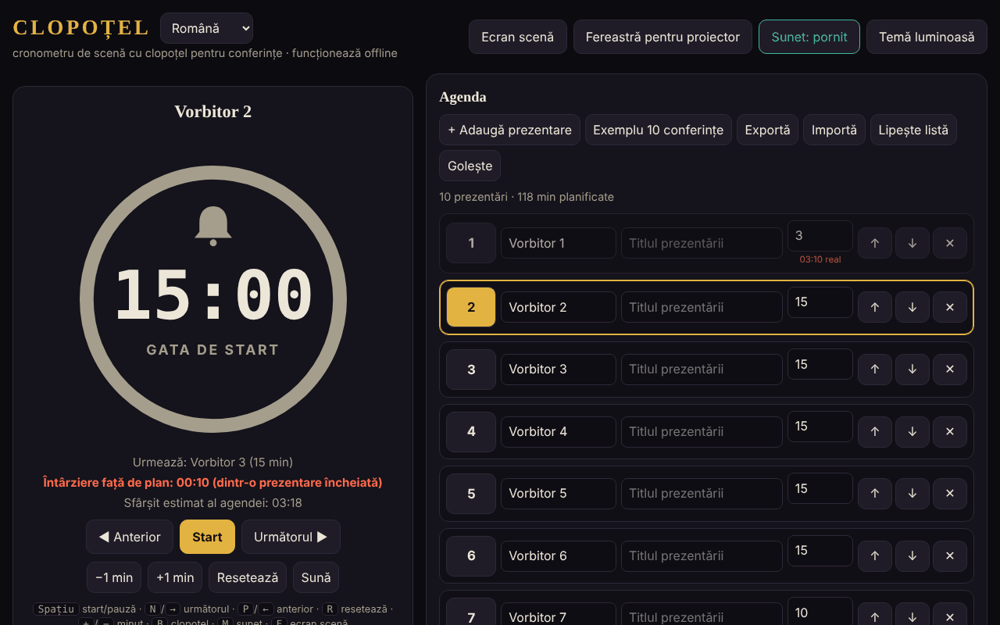

# CLOPOȚEL

[English](README.md) · **Română** · [Français](README.fr.md) · [Italiano](README.it.md) · [Español](README.es.md) · [Português](README.pt.md) · [Deutsch](README.de.md) · [Magyar](README.hu.md)

**Versiune:** 1.2.0 · **Ultima actualizare:** 2026-10-19

Limbile interfeței: **Română, English, Français, Italiano, Español, Português (PT), Deutsch, Magyar**

Cronometru de scenă cu clopoțel pentru conferințe: limitează timpul fiecărui vorbitor din agendă.
Un singur fișier HTML, fără dependențe externe, funcționează complet offline („fără frontiere”, trade-free).

## Utilizare

1. Deschide `index.html` în browser (sau pagina publicată cu GitHub Pages: **https://chiuta.github.io/Clopotel/**).
2. Completează agenda: vorbitor, titlu, minute alocate. Poți muta, șterge, exporta și importa agenda (JSON) sau o poți lipi ca listă text (**Lipește listă**: `Vorbitor | Titlu | minute`, câte o prezentare pe rând; separatori `|`, `;` sau tab; fără minute se folosesc 10). Fișierele `.csv`/`.txt` cu același format se pot importa la fel.
3. Apasă **Start**. Clopoțelul sună la avertizare (implicit cu 2 minute înainte), la final și periodic în depășire.
4. **Ecran scenă** pune cronometrul pe tot ecranul; **Fereastră pentru proiector** deschide o a doua fereastră sincronizată
   (același browser, același calculator) pe care o muți pe ecranul sălii.

## Funcții noi (v1.1.0, 14 octombrie 2026)

Funcții alese după citirea aplicației, pentru ce lipsea unui organizator după eveniment și în sală:

### Raport: plan față de real
Secțiunea pliabilă „Raport: plan față de real” (sub Setări) arată, pentru fiecare prezentare, timpul planificat, timpul real, diferența (roșu = depășit, verde = sub plan), starea (încheiată / în curs / neînceput) și totaluri: suma pe prezentările cronometrate și planul întregii agende. Se actualizează în timp real. „Exportă CSV” descarcă `raport-clopotel.csv` (separator `;`, UTF-8 cu BOM pentru Excel/LibreOffice; celulele care ar putea fi interpretate ca formule sunt neutralizate); „Tipărește raportul” tipărește doar tabelul. Timpii vin din rezultatele pe care Clopoțel le ține deja (o prezentare intră în raport când e încheiată sau părăsită, cea curentă cu timpul de până acum). **Limită:** nu există istoric al evenimentelor anterioare; un „Resetează” sau „Selectează” pe o prezentare ștergde timpul ei real din raport (comportamentul existent).

### Anunțuri vocale (opțional)
Căsuța „Anunțuri vocale” din Setări: la avertizare și la final, pe lângă clopoțel, se spune cu voce tare „Au rămas 2 minute.” / „A rămas un minut.” / „Au rămas N secunde.” / „Timpul a expirat.” (în engleză la limba En). Folosește sinteza vocală a browserului (`speechSynthesis`), respectă volumul și comutatorul „Sunet” (cu sunetul oprit nu se vorbește), este oprită implicit și se dezactivează automat dacă browserul nu are voce. Fereastra pentru proiector nu vorbește (evită dublarea). **Limită:** calitatea și limba vocii depind de sistem; unele sisteme nu au voce românească și citesc cu accent străin; unele voci sunt furnizate online de producătorul browserului, în afara controlului aplicației.

Interfața are 8 limbi (RO, EN, FR, IT, ES, PT, DE, HU), alese din selectorul de limbă; și kitul are interfața în 8 limbi.

### Transparență și copie de siguranță (fff-kit)

Un clic (sau Enter) pe versiunea afișată (`v 1.1.1 · 2026-10-18`) deschide fereastra „Transparență”: gazdele de rețea declarate (0 cereri externe), cheile de stocare locală cu dimensiuni, API-urile folosite, mărimea și SHA-256 al fișierului (cu verificator pentru un fișier descărcat) și **copia de siguranță** a datelor aplicației într-un fișier `.fff.json` (opțional criptat cu parolă, AES-GCM 256 / PBKDF2; parola nu poate fi recuperată), import cu confirmare și ștergerea datelor aplicației. Kitul (`fff-kit`, module: core, label, bundle) este lipit în `index.html`, nu face cereri de rețea și nu schimbă datele existente; fără el aplicația funcționează la fel. Textele kitului sunt în 8 limbi (ro, en, fr, it, es, pt, hu, de); **traducerile fr/it/es/pt/hu/de sunt automate și neverificate nativ**. Interfața aplicației însăși rămâne în română.

## Scurtături

| Tastă | Acțiune |
|---|---|
| Spațiu | Start / pauză |
| N sau → | Următorul vorbitor |
| P sau ← | Anterior |
| R | Resetează |
| + / − | Adaugă / scade un minut |
| B | Sună clopoțelul |
| M | Sunet pornit / oprit |
| F | Ecran scenă |

## Note

- Selectorul de limbă de lângă titlu comută interfața între cele 8 limbi (alegerea se păstrează în browser; fereastra pentru proiector o urmează).
- Butonul **Temă luminoasă/întunecată** schimbă tema (implicit întunecată, potrivită pentru scenă); alegerea se păstrează în browser. Tipărirea (Ctrl+P) produce doar agenda, în alb-negru.
- Browserul blochează sunetul până la primul clic: apasă Start sau orice buton înainte de eveniment.
- Datele (agenda, setările, starea cronometrului) se păstrează în browser (`localStorage`); după o reîncărcare, cronometrul continuă.
- Ecranul rămâne aprins cât timp cronometrul rulează (Wake Lock, unde browserul îl suportă).

## Publicare cu GitHub Pages

Settings → Pages → Source: *Deploy from a branch* → `main` / `(root)`. Fișierul `.nojekyll` este deja inclus.

## Istoric / Changelog

### 1.1.1 — 18 octombrie 2026
- Importul unei agende din fișier (`.json`, `.csv`, `.txt`) cere acum confirmare înainte de a înlocui agenda existentă (ca „Lipește lista”); dacă renunți, nici agenda, nici setările nu se schimbă. Nu există „anulează” după înlocuire: exportă agenda înainte să imporți.

### 1.1.0 — 14 octombrie 2026
- Raport plan/real (+ CSV, tipărire); anunțuri vocale opționale; fff-kit (Transparență + copie de siguranță); secțiunile pliabile Setări și Raport sunt acum într-un punct de reper (`aside`) pentru accesibilitate (axe `region` era încălcat înainte).

### 1.0.0 — 12 octombrie 2026
- Versiunea și data ultimei actualizări sunt afișate în aplicație (subsol).

### 11.10.2026 (a treia actualizare) — 11 octombrie 2026
- Interfață în două limbi: română și engleză (buton lângă titlu), inclusiv etichete ARIA, mesaje, scurtături și text de ajutor; verificat cu axe în ambele limbi.
- Linia „Avans/Întârziere față de plan” arată acum pe câte prezentări încheiate se bazează calculul (evită confuzia după o trecere rapidă peste vorbitori).
- CSP: `connect-src 'none'` (aplicația nu face cereri de rețea).

### 11.10.2026 (a doua actualizare) — 11 octombrie 2026
- Import agendă din text lipit sau din fișier `.csv`/`.txt` (rânduri `Vorbitor | Titlu | minute`), cu mesaj despre rândurile importate sau ajustate.
- Temă luminoasă (contrast verificat cu axe) și stil de tipărire pentru agendă; fereastra pentru proiector urmează tema aleasă.

### 11.10.2026 — 11 octombrie 2026
- Fereastra pentru proiector: dacă browserul blochează fereastra pop-up, apare acum un mesaj clar cu pașii de urmat (în loc de nicio reacție).
- Adăugat Content-Security-Policy strict (script cu hash, fără rețea); verificare axe fără încălcări.

## Licență

MIT — vezi [LICENSE](LICENSE).

Autor: Alexandru-Ionuț Chiuță (Alexio) · <alexio@trom.tf>

